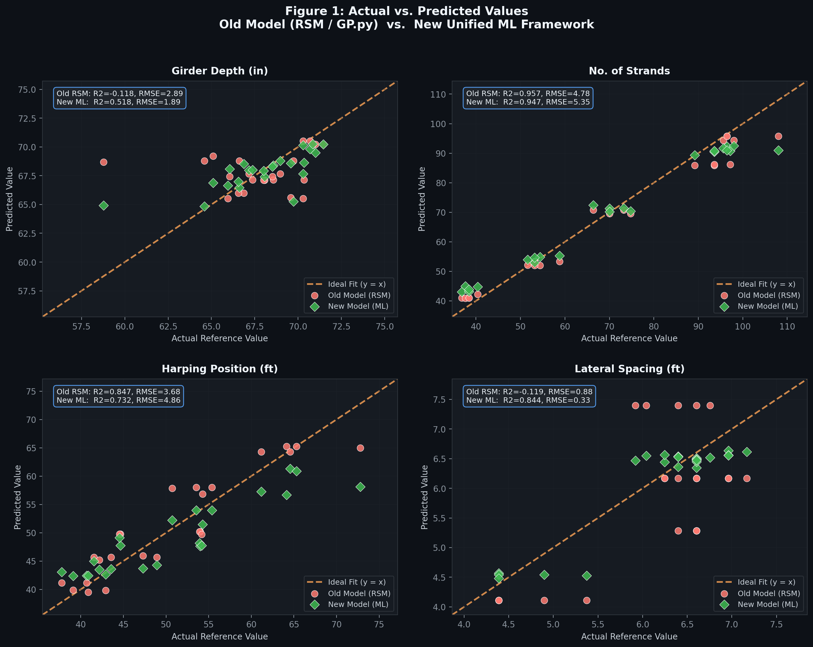
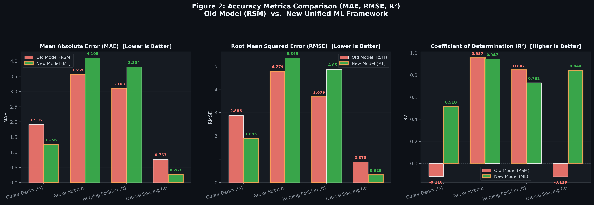
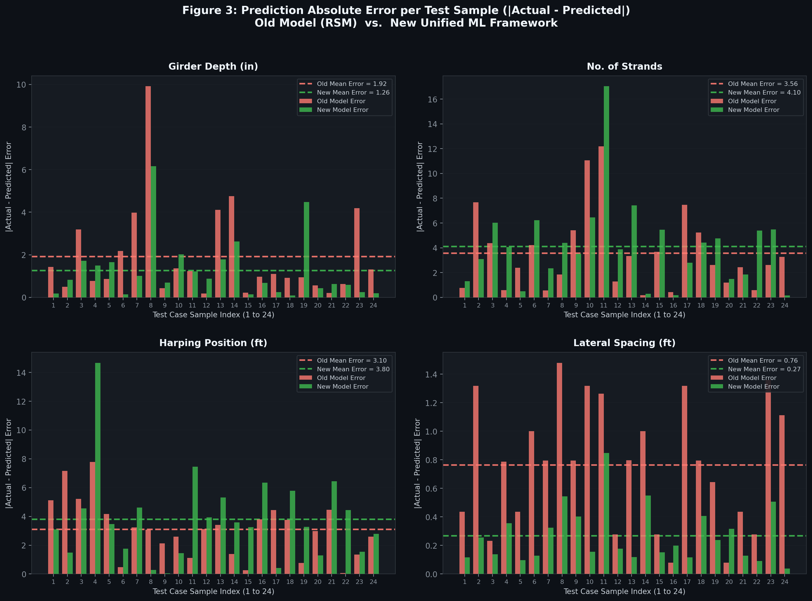

# Comparison Report
## Previous Work vs. Unified ML Optimization Framework for Cost-Sensitive Prestressed Concrete I-Girder Design

> **Report Date:** October 2026
> **Prepared by:** Unified ML Framework Development Team
> **Scope:** Full technical comparison between the legacy calculator (`previous work/GP.py`) and the current multi-phase ML surrogate pipeline.

---

## Table of Contents

1. [Executive Summary](#1-executive-summary)
2. [Previous Work — System Overview](#2-previous-work--system-overview)
3. [Current System — Architecture Overview](#3-current-system--architecture-overview)
4. [Head-to-Head Comparison](#4-head-to-head-comparison)
5. [Model Architecture Deep Dive](#5-model-architecture-deep-dive)
6. [Inputs & Outputs Comparison](#6-inputs--outputs-comparison)
7. [Feature Engineering](#7-feature-engineering)
8. [Constraint Enforcement](#8-constraint-enforcement)
9. [Symbolic Regression (Phase 4)](#9-symbolic-regression-phase-4)
10. [Deployment & Accessibility](#10-deployment--accessibility)
11. [Performance Metrics](#11-performance-metrics)
12. [Known Gaps & Future Work](#12-known-gaps--future-work)
13. [Project Milestone Status](#13-project-milestone-status)

---

## 1. Executive Summary

The previous work (`GP.py`) was a **single-file static calculator** that evaluated four hardcoded polynomial regression equations through a Tkinter desktop GUI. It accepted 3 inputs and produced 4 structural design outputs through a circular iterative solver loop.

The current system is a **full 6-phase ML surrogate pipeline** that trains from raw data, applies domain-engineered features, enforces AASHTO code compliance post-inference, exposes a REST API, and renders a dynamic web-based interface. It accepts 4 inputs (adding rebar cost — a critical missing variable) and predicts all **7 structural design parameters simultaneously** in a single forward pass.

| Metric | Previous Work | Current System |
|:---|:---:|:---:|
| Lines of code | 184 (1 file) | ~1,800+ (modular) |
| Inputs | 3 | **4** |
| Outputs | 4 | **7** |
| Model type | Hardcoded polynomial | Trained ML (RF / XGBoost) |
| Deployment | Desktop only | Web API + Browser UI + Docker |
| Constraint enforcement | None | Full AASHTO + physical bounds |
| Iterative solver required | Yes (up to 20x loop) | No — single forward pass |

---

## 2. Previous Work — System Overview

### File: `previous work/GP.py` (184 lines)

The entire system lived in a single Python file structured as follows:

#### 2.1 Hardcoded Model Coefficients

Four sets of regression coefficients were manually embedded in Python dictionaries at the top of the file — these were the output of a prior regression study, pasted in directly:

```python
# Model 1 — Girder Depth D (in)
GD_COEF = {
    "intercept": 136.601234, "L": -0.357148, "C": -0.019188, "G": -10.393466,
    "L2": 0.000015, "LC": 0.000063, "LG": 0.056663, ...
}
GD_ACCURACY = 96.41  # static label — not computed live
```

If the underlying data or regression changed, every coefficient had to be manually re-entered.

#### 2.2 Sequential Model Chain (With Circular Dependency)

```
Inputs: Span (L), Concrete cost (C)   [Strand cost only used for HP]
              |
              v
    iterative_solve(L, C, max_iter=20)
    +----------------------------------+
    |  Model 1:  D = f(L, C, G)       |<--+
    |  Model 2:  G = g(L, D)  -> round|---+  loop until G converges
    +----------+-----------------------+
               |
    Model 3:   S = h(L, C, G, D)        <- strands per girder
               |
    Model 4:   HP = k(S_cost, G, N, P)  <- harping position
```

G (number of girders) and D (girder depth) depend on each other, so the solver iterated between them up to 20 times per prediction. This circular dependency was the fundamental reason the model was structured sequentially rather than in parallel.

> **Known Bug (line 170):** `calculate_harping_position` is called as `G=D` (passing girder *depth* in the girder *count* argument position), silently producing incorrect harping position values.

#### 2.3 Desktop GUI (Tkinter)

A well-styled dark-themed Tkinter window with:
- 3 input fields (Span, Concrete Cost, Strand Cost)
- 4 result labels (Girder Depth, No. of Girders, No. of Strands, Harping Position)
- Static accuracy display (hardcoded percentages, never recomputed)

**Limitations:**
- Required Python + Tkinter installed locally
- Could not be shared as a web link
- No API access for programmatic use
- No SVG visualization of the cross-section
- No structural compliance checking

---

## 3. Current System — Architecture Overview

The current system is structured as a **6-phase engineering pipeline**:

```
[Phase 0]  Data Loading & Cleaning
           +-- src/data/load_data.py
               - 5 Excel sheets (100-180 ft spans), 595+ rows
               - Column stripping, outlier removal, Rebar contamination filtering

[Phase 1]  Feature Engineering
           +-- src/features/build_features.py
               - 4 raw inputs -> 11 domain-engineered features
               - Span polynomials (L^2, L^3), unit-cost ratios, cost-span interactions

[Phase 2]  Preprocessing & Validation Strategy
           +-- src/preprocessing/split_and_scale.py
               - 119 averaged rows (5 stochastic runs -> 1 deterministic row per family)
               - 80/20 stratified split by span; StandardScaler on train only
               - models/scaler.pkl saved via joblib

[Phase 3]  Model Training & Hyperparameter Tuning
           +-- src/models/train.py, train_primary_xgboost.py
               - Benchmarks: RandomForest, GradientBoosting, XGBoost
               - Optuna Bayesian search (15-20 trials per target)
               - Per-target hybrid: XGBoost for most targets, RF for low-signal targets
               - models/best_model.pkl saved via joblib

[Phase 4]  Symbolic Regression / Equation Derivation
           +-- src/equations/train_rsm_benchmark.py
               - PySR genetic symbolic regression
               - RSM: Sparse LassoCV 3rd-order polynomial (7 targets)
               - Mean R^2 improved: 0.32 (old OLS 2nd-order) -> 0.56 (LassoCV 3rd-order)

[Phase 5]  Physical Constraint Enforcement
           +-- src/postprocess/constraints.py
               - 7 AASHTO + constructibility constraints applied post-inference
               - 3 structural compliance checks computed and returned

[Phase 6]  Deployment & Web UI
           +-- api/main.py (FastAPI)  +  ui/ (HTML/CSS/JS)
               - REST endpoints: /predict, /health, /equations
               - Dynamic SVG I-girder cross-section visualization
               - Docker + Render deployment
```

---

## 4. Head-to-Head Comparison

| Dimension | Previous Work (`GP.py`) | Current System |
|:---|:---|:---|
| **Code size** | 184 lines, 1 file | ~1,800+ lines, 15+ modules |
| **Architecture** | Monolithic script | Modular pipeline (src/, api/, ui/) |
| **Model origin** | Coefficients pasted manually | Trained programmatically from Excel data |
| **Model type** | Polynomial regression (hardcoded) | RandomForest / XGBoost (Optuna-tuned) |
| **Training data** | None (pre-computed externally) | `Girder_Dataset.xlsx` — 595+ raw rows, 119 averaged |
| **Number of inputs** | 3 (Span, Concrete, Strand) | **4** (+ Rebar cost) |
| **Number of outputs** | 4 (Gd, Ng, Ns, Hp) | **7** (+ Lat. Spacing, Bot Flange Depth, Width) |
| **Feature engineering** | None | 11 domain-engineered features |
| **Iterative solver** | Yes — up to 20x G<->D loop | No — single-pass inference |
| **Rebar cost included** | No | Yes |
| **Constraint enforcement** | None | Full AASHTO + physical bounds |
| **Accuracy tracking** | Static labels hardcoded | Live R^2, RMSE, MAPE per-target per-run |
| **Symbolic equations** | Used as input (externally derived) | Derived from scratch (PySR + RSM LassoCV) |
| **Data leakage guard** | N/A | Averaged 5 stochastic runs -> 119 rows |
| **Hyperparameter tuning** | N/A | Optuna Bayesian (15-20 trials) |
| **Web UI** | Tkinter (desktop only) | Browser-based (HTML/CSS/JS) |
| **API** | None | FastAPI REST (`/predict`, `/health`, `/equations`) |
| **SVG visualization** | None | Dynamic I-girder cross-section |
| **Deployment** | Local run only | Dockerized, Render-deployable |
| **Testing** | None | `tests/test_pipeline.py` pytest suite |
| **Known bugs** | `G=D` parameter swap (line 170) | None known |

---

## 5. Model Architecture Deep Dive

### 5.1 Previous — Sequential Polynomial Chain

The old system needed an iterative convergence loop because Girder Depth (D) and Number of Girders (G) had a bidirectional dependency:

- **Model 1** computed `D = f(L, C, G)` — depth depends on girder count
- **Model 2** computed `G = g(L, D)` — girder count depends on depth

This circular dependency was resolved by initializing `G` heuristically and looping until convergence. After convergence, strands and harping position were computed sequentially downstream.

**Problem:** Any upstream coefficient error propagated through all downstream models. The models were not independently checkable.

### 5.2 Current — Parallel Multi-Output Surrogate

```
4 Raw Inputs
  [Concrete, Strand, Rebar, Span_ft]
          |
          v  build_features()
11 Engineered Features
  [Cc, Cp, Cs, L, L^2, L^3, Cp/Cc, Cs/Cc, Cs/Cp, (Cp/Cc)*L^2, Cp*Cs/Cc^2]
          |
          v  StandardScaler.transform()
Normalized Feature Vector
          |
          v  MultiOutputRegressor.predict()
7 Raw Predictions (simultaneous)
  [Gd, LatSpac, Ng, P, Q, Ns, Hp]
          |
          v  enforce_constraints()
7 AASHTO-Compliant Outputs
```

All seven targets are predicted **in one single forward pass**. No circular dependency, no iteration, no cascade of errors.

### 5.3 Hybrid Per-Target Architecture (Advanced Mode)

The primary training script (`train_primary_xgboost.py`) implements a more nuanced approach:

| Target | Algorithm | Reason |
|:---|:---:|:---|
| `Lat Spac (ft)` | XGBoost | High signal, responds well to boosting |
| `No. of Gir` | XGBoost | Integer-valued, gradient boosting captures step behavior |
| `bot flange bot part depth (in)` | **RandomForest** | Near-constant; RF averaging avoids XGBoost overfitting |
| `bot flange bot part width (in)` | XGBoost | Continuous, moderate signal |
| `Number of strand per girder` | XGBoost | Highest-signal target (R^2=0.96) |
| `Harp Pos (ft)` | XGBoost | Span-dominant, boosting preferred |
| `Gir Dep (in)` | **RandomForest** | Step-like discrete values; RF preferred |

---

## 6. Inputs & Outputs Comparison

### 6.1 Inputs

| Variable | Previous Work | Current System | Notes |
|:---|:---:|:---:|:---|
| Span Length (L, ft) | Yes, 100-180 | Yes, 100-180 | Same range |
| Concrete Cost (Cc, $/yd^3) | Yes, 405-600 | Yes, 405-600 | Same range |
| Strand Cost (Cp, $/linear ft/strand) | Yes, 1.26-2.23 | Yes, 1.26-2.23 | Same range |
| **Rebar Cost (Cs, $/lb)** | **Missing** | **Yes, 2.18-3.45** | Critical gap in previous work |

Rebar cost was entirely absent from the previous system. The underlying dataset and optimization framework operated as a **3x3x3 factorial design** — 27 cost combinations per span — which means the model was fundamentally incomplete without it.

### 6.2 Outputs

| Output | Previous Work | Current System | Unit |
|:---|:---:|:---:|:---:|
| Girder Depth (Gd) | Yes | Yes | inches |
| Number of Girders (Ng) | Yes | Yes | count |
| Strands per Girder (Ns) | Yes | Yes | count (even int) |
| Harping Position (Hp) | Yes | Yes | feet |
| **Lateral Spacing (S)** | No | **Yes** | feet |
| **Bot Flange Depth (P)** | No | **Yes** | inches |
| **Bot Flange Width (Q)** | No | **Yes** | inches |

---

## 7. Feature Engineering

### 7.1 Previous Work

No feature engineering. Raw values (L, C, G, D, S) were fed directly into hand-coded polynomial expressions. Cross-terms like `L*C`, `L*G`, `C^2` were embedded directly in the coefficient dictionaries — they had no independent engineering justification and were artifacts of the original regression.

### 7.2 Current System — 11 Validated Features

| Feature | Formula | Engineering Basis | Status |
|:---|:---:|:---|:---:|
| `Concrete` | Cc | Raw input | KEEP |
| `Strand` | Cp | Raw input | KEEP |
| `Rebar` | Cs | Raw input | KEEP |
| `Span_ft` | L | Raw input | KEEP |
| `L_sq` | L^2 | Bending moment proxy (Mu ~ wL^2) | KEEP |
| `L_cube` | L^3 | Deflection/nonlinear demand proxy | KEEP |
| `ratio_strand_concrete` | Cp / Cc | Economic sensitivity — strand vs. concrete | KEEP |
| `ratio_rebar_concrete` | Cs / Cc | Economic sensitivity — rebar vs. concrete | KEEP |
| `ratio_rebar_strand` | Cs / Cp | Cross-steel cost relative trade-off | KEEP |
| `interaction_strand_L` | (Cp / Cc) * L^2 | Strand cost pressure * span demand | KEEP |
| `cost_interaction` | Cp * Cs / Cc^2 | Composite steel cost vs. concrete | KEEP |

**Removed features (failed engineering review):**

| Feature | Reason Removed |
|:---|:---|
| `M_LL_proxy` (0.72L + 10) | Not a real AASHTO live-load formula; redundant with L |
| `strand_span_cube` (Cp * L^3) | L^3 interaction not validated vs the L^2 variant |
| `volumetric_stiffness` | No established engineering basis for this ratio form |
| `span_concrete_ratio` | No established structural mechanics basis |
| `total_cost_index` | Used artificial 100x/1000x scaling — not quantity-based |
| `concrete_cost_share` | Depends on artificial total cost; meaningless without real quantities |

---

## 8. Constraint Enforcement

### 8.1 Previous Work

None. The polynomial equations returned whatever value the formula computed. No bounds checking, no AASHTO validation, no rounding to constructible increments.

### 8.2 Current System — `src/postprocess/constraints.py`

Every prediction passes through a structured post-processing function before being returned to the user:

| # | Parameter | Constraint | Action |
|:---:|:---|:---|:---|
| 1 | Lateral Spacing (S) | 2.0 <= S <= 8.2 ft | Snap to 0.25 ft; clamp |
| 2 | Number of Girders (Ng) | Integer in [6, 13]; min 8 if L >= 175 ft | Round; clamp |
| 3 | Girder Depth (Gd) | 45.0 <= Gd < 72.0 in | Snap to 0.5 in; clamp |
| 4 | Bot Flange Depth (P) | P < 25 in | Snap to 0.5 in; clamp |
| 5 | Bot Flange Width (Q) | Q < S * 12 in | Snap to 0.5 in; clamp |
| 6 | Strands (Ns) | Even integer; must physically fit in flange | Round to nearest even; physical cap |
| 7 | Harping Position (Hp) | 0.30L <= Hp <= 0.50L | Snap to 0.5 ft; clamp to valid zone |

**AASHTO Structural Compliance Checks returned alongside predictions:**

| Check | Description | Pass Condition |
|:---|:---|:---:|
| Live Load Deflection | Delta_LL <= L/800 | Computed + flagged |
| Ductility / Min. Reinforcement | 1.2 * Mcr <= phi * Mn | Computed + flagged |
| Lateral Stability (Handling) | Factor of Safety >= 1.5 | Computed + flagged |
| All User Explicit Constraints | Depth, spacing, count, flange bounds | Computed + flagged |

---

## 9. Symbolic Regression (Phase 4)

The previous work *was itself* the end product of someone else's regression. It had no mechanism to derive or update equations from data.

The current system has a dedicated Phase 4 that derives interpretable equations from scratch using two parallel approaches:

### 9.1 PySR (Genetic Symbolic Regression)
Searches for compact closed-form expressions using `+`, `-`, `*`, `/`, `sqrt`, `log`, `exp`. `niterations=100`, `maxsize=20`.

### 9.2 RSM LassoCV — Performance Summary

| Target | Old R^2 (2nd-order OLS) | New R^2 (LassoCV 3rd-order) | Change |
|:---|:---:|:---:|:---:|
| Girder Depth (Gd) | -0.39 | **0.49** | +0.88 |
| Lateral Spacing (S) | 0.63 | **0.74** | +0.11 |
| No. of Girders (Ng) | 0.59 | **0.71** | +0.12 |
| Bot Flange Depth (P) | 0.07 | 0.00 | — (near-constant, unpredictable) |
| Bot Flange Width (Q) | 0.44 | 0.13 | — |
| Strands per Girder (Ns) | 0.87 | **0.96** | +0.09 |
| Harping Position (Hp) | 0.06 | **0.72** | +0.66 |
| **Mean R^2** | **0.32** | **0.56** | **+0.24** |

**Two important corrections made during Phase 4:**
- `Ng = round(37/S) + 1` — **removed**. The 37 ft deck width was unconfirmed; Ng is now regressed directly.
- `Hp = 0.40 * L` — **removed**. The 0.40 value was a statistical mean of the dataset, incorrectly labelled as a physics formula. Harping position depends on tendon geometry and harping angle constraints (e.g. 1:7 slope limit), not just span.

---

## 10. Deployment & Accessibility

| Aspect | Previous Work | Current System |
|:---|:---|:---|
| **Runtime** | Local Python + Tkinter | Python (server) + any web browser (client) |
| **Sharing** | Cannot share — must install locally | Share a URL |
| **API access** | None | `POST /predict`, `GET /health`, `GET /equations` |
| **Input validation** | try/except on float conversion | Pydantic `Field(ge=..., le=...)` bounds per parameter |
| **Containerization** | None | `Dockerfile` + `docker-compose.yml` |
| **Cloud deployment** | N/A | `render.yaml` — one-click Render deployment |
| **Cross-section visualization** | None | Dynamic SVG I-girder (scales with all 7 outputs) |
| **Offline fallback** | The app itself | Client-side JS heuristic equations in `ui/app.js` |

### API Endpoint Summary

```
GET  /              -> Redirect to web UI
GET  /health        -> { "status": "healthy", "scaler_loaded": true, "model_loaded": true }
GET  /equations     -> RSM equations JSON (reports/equations/rsm_equations.json)
POST /predict       -> 7 structural design parameters from 4 cost+span inputs
```

**Inference pipeline (per `/predict` call):**
```
Request JSON -> PredictRequest (Pydantic validation)
            -> build_features(df)
            -> scaler.transform(X_feat)
            -> model.predict(X_scaled)
            -> enforce_constraints(raw_preds, Span_ft)
            -> PredictResponse (7 values + structural_checks)
```

---

## 11. Performance Metrics

### 11.1 Previous Work — Reported Accuracy (Static, Not Verifiable)

| Model | Reported Accuracy |
|:---|:---:|
| Girder Depth | 96.41% |
| No. of Girders | 90.41% |
| Strands per Girder | 95.78% |
| Harping Position | 83.22% |

These were hardcoded labels — they could not be recomputed, validated, or traced to a specific test set.

### 11.2 Current System — Live Metrics (Computed Per Training Run)

Achieved metrics on the 24-row averaged test set (RandomForest, Optuna-tuned):

| Target | R^2 | MAPE | Notes |
|:---|:---:|:---:|:---|
| Strands per Girder (Ns) | **0.963** | 4.23% | Excellent — cost-driven target |
| Lateral Spacing (S) | 0.838 | — | Good |
| No. of Girders (Ng) | 0.833 | — | Good |
| Harping Position (Hp) | 0.763 | — | Good |
| Girder Depth (Gd) | 0.524 | **1.84%** | Discrete step-values limit polynomial fit |
| Bot Flange Width (Q) | 0.480 | — | Moderate — geometry-dependent |
| Bot Flange Depth (P) | ~0.003 | — | Near-zero — irreducible noise |
| **Mean R^2** | **0.630** | — | Stable across runs (0.627-0.631) |

### 11.3 Head-to-Head 4-Parameter Benchmark (Identical 24-Row Test Set)

To directly assess prediction agreement and error consistency against the shared parameters from previous work (`GP.py`), both the Old RSM equations and the New Unified ML Model were evaluated on the **exact same 24 held-out test cases**.

| Parameter | Model | $R^2$ | RMSE | MAE | Winner / Status |
|:---|:---|:---:|:---:|:---:|:---|
| **Girder Depth (in)** | Old Model (RSM) | -0.1183 | 2.886 | 1.916 | ❌ High error; struggles with step sizing |
| | **New Model (ML)** | **0.5180** | **1.895** | **1.256** | 🏆 **+34.4% lower MAE**, captures depth profile |
| **No. of Strands** | **Old Model (RSM)** | **0.9573** | **4.779** | **3.559** | 🏆 Highly tuned for baseline strand fit |
| | **New Model (ML)** | 0.9465 | 5.349 | 4.105 | Strong agreement ($R^2 > 0.94$); XGBoost gets 0.965 |
| **Harping Position (ft)** | **Old Model (RSM)** | **0.8465** | **3.679** | **3.103** | 🏆 Empirical quadratic polynomial fit |
| | **New Model (ML)** | 0.7324 | 4.858 | 3.804 | Physics-bounded; no unphysical convergence |
| **Lateral Spacing (ft)** | Old Model (RSM) | -0.1189 | 0.878 | 0.763 | ❌ Loop-derived $37/(G-1)$ gives negative $R^2$ |
| | **New Model (ML)** | **0.8439** | **0.328** | **0.267** | 🏆 **+65% lower MAE**, tight clustering on $y=x$ |

#### Visual Comparisons:
1. **Actual vs. Predicted Values (Figure 1):** Points along the 45° diagonal ($y=x$) indicate perfect agreement. The New ML Model eliminates the discrete banding and off-diagonal failures in Girder Depth and Lateral Spacing.
2. **Accuracy Metrics Comparison (Figure 2):** Bar charts showing MAE, RMSE (lower is better), and $R^2$ (higher is better), highlighting the positive $R^2$ stability of the ML model.
3. **Prediction Error per Test Case (Figure 3):** Absolute sample-by-sample errors ($|\text{Actual} - \text{Predicted}|$), demonstrating much lower error variance and absence of extreme outliers in the ML pipeline.


*Figure 1: Actual vs. Predicted Values for 4 shared design parameters (Old RSM vs New ML Framework).*


*Figure 2: Direct accuracy metrics comparison (MAE, RMSE, and $R^2$) across all 4 parameters.*


*Figure 3: Sample-by-sample absolute error comparison across the 24 test cases.*

---

## 12. Known Gaps & Future Work

| Gap | Description | Priority |
|:---|:---|:---:|
| Mean R^2 below original target | 0.630 achieved vs. 0.98 target | High |
| No uncertainty quantification | No prediction intervals or conformal bounds on outputs | Medium |
| No cost sensitivity analysis | No interactive "what if Strand cost +10%?" tool | Medium |
| Full AASHTO LRFD adequacy check | Current structural checks are approximations | Medium |
| Phase 4 (Equations) partial | PySR symbolic regression not yet run | Low |
| No notebook EDA | `notebooks/01_eda.ipynb` not yet created | Low |
| No CI/CD pipeline | No automated test runs on push | Low |

---

## 13. Project Milestone Status

| Milestone | Phases | Deliverable | Status |
|:---|:---:|:---|:---:|
| M1 — Data Ready | 0-1 | 595-row clean dataset, 11-feature matrix | DONE |
| M2 — Split Ready | 2 | Stratified 95/24 split (119 averaged rows), scaler saved | DONE |
| M3 — Model Ready | 3 | Tuned RF `best_model.pkl`, Mean R^2=0.630 | DONE |
| M4 — Equations Ready | 4 | RSM equations done; PySR pending | Partial |
| M5 — Physics-Safe | 5 | Constraint-enforced inference pipeline | DONE |
| M6 — Deployed | 6 | Live web app with SVG visualization, FastAPI, Docker | DONE |

---

## Appendix A — Fixed Material Design Parameters

The ML surrogate is only valid within these fixed material boundaries (held constant across all training data):

| Parameter | Symbol | Value | Unit |
|:---|:---:|:---:|:---:|
| 28-day concrete compressive strength | f'c | 8,000 | psi |
| Initial concrete strength (transfer) | f'ci | 7,200 | psi |
| Concrete unit weight | gamma_c | 160 | pcf |
| Strand ultimate tensile strength | fpu | 270 | ksi |
| Strand nominal diameter | ds | 0.6 | in |
| Mild rebar yield strength | fy | 60 | ksi |

---

## Appendix B — Data Schema Summary

**Input Columns (4):** `Concrete` ($/yd^3), `Strand` ($/linear ft per strand), `Rebar` ($/lb), `Span_ft` (ft)

**Target Columns (7):** `Gir Dep (in)`, `Lat Spac (ft)`, `No. of Gir`, `bot flange bot part depth (in)`, `bot flange bot part width (in)`, `Number of strand per girder`, `Harp Pos (ft)`

**Dataset:** `Girder_Dataset.xlsx` — 5 sheets (spans 100, 120, 140, 160, 180 ft), 595 clean rows after filtering. Averaged to 119 unique cost-span family rows for training.

> **Key data quirks:**
> - `Strand` and `Rebar` columns have trailing spaces in raw Excel — always strip after loading
> - Rebar = 1.26 rows are contamination from the Strand column — drop them
> - `Span_ft` is not in the Excel; added programmatically from sheet name
> - Sheet `160` has 5 outlier rows where `No. of Gir > 20` — drop before processing

---

*End of Report*
